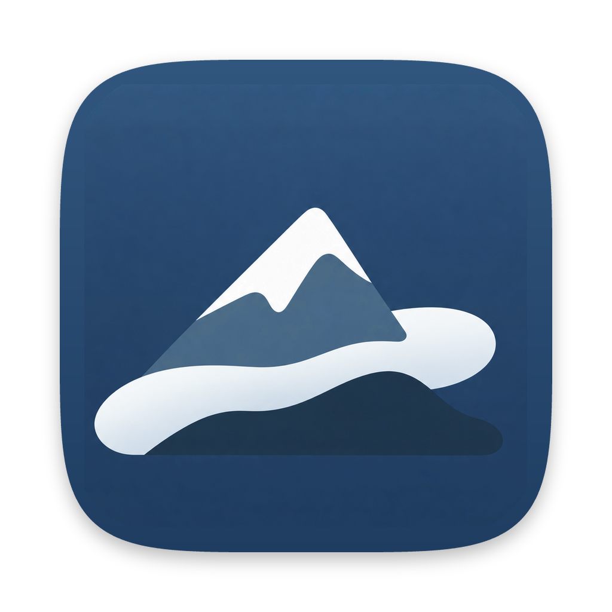
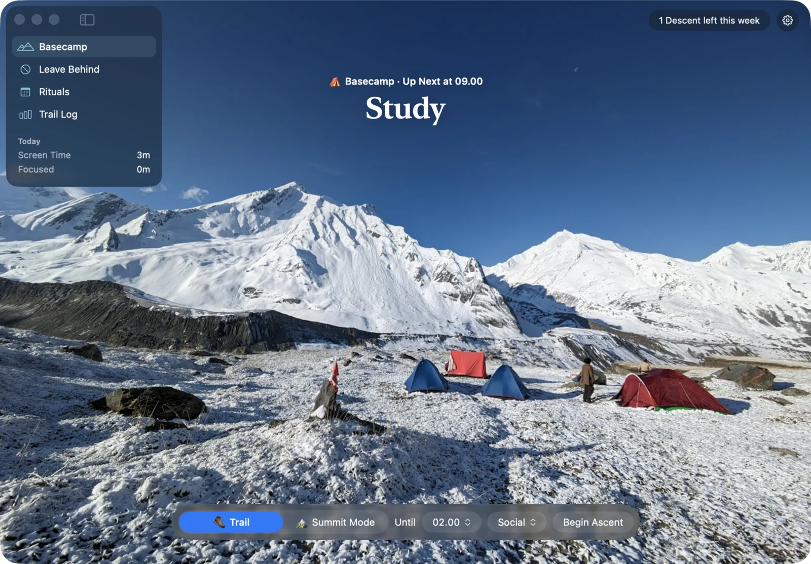
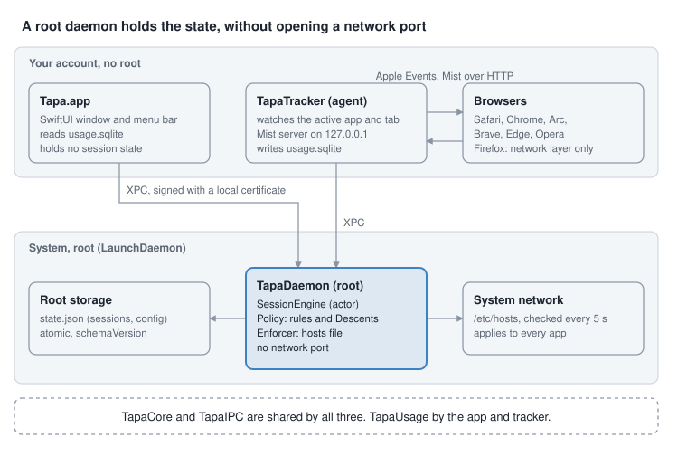

<p align="center">
    
</p>

<h1 align="center">Tapa</h1>

<p align="center"><em>A quieter path to focus.</em></p>

<p align="center">
    Leave the noisy websites at basecamp and set off on an Ascent.<br>
    Tapa keeps them closed until you're back, even if you quit the app or restart your Mac.
</p>

<p align="center">
    <a href="#installation">Install</a> ·
    <a href="#features">Features</a> ·
    <a href="#architecture">Architecture</a>
</p>

<p align="center">
    
</p>

<p align="center">
    
    
    
    <a href="LICENSE"></a>
</p>

## Why Tapa?

Most website blockers give way the moment you want them to. Quit the app, flip a switch, and the distraction is back. Tapa lets you choose how firm the block is before you start. A Trail can be ended any time. Summit Mode holds until the time you picked, with only a couple of ways out each week.

It does this without guilt. There are no streaks, scores or red warnings, only a quiet page of mist where the website would have been.

The name comes from the Indonesian word *bertapa*: withdrawing from the crowd to focus.

## Features

### Trail and Summit Mode

Every session is an Ascent that runs until a time you choose, up to 12 hours ahead.

- **Trail** is flexible focus. Take a Rest Stop or end it whenever you need to.
- **Summit Mode** is committed focus. It starts only after you agree to the Summit Oath, and it can't be ended early. If something urgent comes up, a Descent ends it. You get 2 Descents a week, and each asks for a short reason first.

Sessions end on time even if the Mac sleeps or the system clock is changed.

### Leave Behind

Group the websites you want to leave behind into lists, like Social or Video, and pick one or more lists when you begin an Ascent. Common subdomains such as `www.` and `m.` are blocked with them. During Summit Mode you can add websites to a list, but not remove them.

### Mist

When you open a blocked website in Safari, Chrome, Arc, Brave, Edge or Opera, the tab turns into Mist: a misty mountain photo, a calm line and the time left. When the Ascent ends or a Rest Stop begins, the tab goes back to where you were. Other browsers are still blocked at the network level, they just show their own error page.

### Rest Stops

On a Trail you can take a short break of 1 to 15 minutes. Each one starts after a wait that grows through the Ascent, 30 seconds for the first, then 60, then 90. The wait gives you a moment to decide whether you really need it.

### Rituals

Rituals are Ascents on a schedule, like Work Time on weekdays from 09.00 to 17.00. They start on their own, so focus doesn't depend on remembering to begin. A Summit Mode Ritual asks for the Oath once, when you save it.

### Menu bar

The menu bar shows the time left. Its panel lets you take a Rest Stop, end a Trail or open Tapa without leaving what you're doing.

## Installation

There is no release yet, so for now Tapa is installed from source. You need macOS 14 or later and the Xcode Command Line Tools (`xcode-select --install`).

```sh
git clone https://github.com/tkgalon/tapa.git
cd tapa
scripts/install.sh
```

Run it as yourself, without `sudo`. The script:

1. Creates a local code signing certificate, Tapa Local Signing, in your login keychain. The daemon uses it to check that only Tapa talks to it.
2. Builds and signs Tapa.
3. Asks for your password once to install the daemon and `tapactl`. The daemon runs as root and blocks websites through `/etc/hosts`, inside a block it marks as Tapa's own.
4. Puts Tapa.app in /Applications and opens it.

The first time a blocked website opens, macOS asks whether Tapa may control that browser. Allow it so the tab can turn into Mist. You can check which browsers are allowed in Tapa's Settings.

To remove Tapa, run the script below or use Uninstall in Settings. Both wait until Summit Mode has ended.

```sh
scripts/uninstall.sh
```

Uninstalling stops the daemon, removes Tapa's block from `/etc/hosts`, and deletes Tapa.app, `tapactl`, the tracker, the signing certificate and your Screen Time history. Nothing of Tapa is left behind.

## How it works

1. **Basecamp.** Pick Trail or Summit Mode, an end time and the lists to leave behind.
2. **Begin Ascent.** The websites on those lists are blocked right away, in every browser and app.
3. **Stay on your path.** Opening a blocked website shows Mist instead. The menu bar keeps the time left in view.
4. **Rest or descend.** On a Trail, take a Rest Stop or end the Trail. In Summit Mode, the only early way out is a Descent.
5. **Summit reached.** At the end time the block lifts and open tabs return to where they were.

## Architecture

Tapa is split so that nothing you can quit holds the block. A root daemon owns every rule, and the app only asks it for changes.

<p align="center"></p>

| Part | Runs as | What it does |
| --- | --- | --- |
| TapaDaemon | root, LaunchDaemon | Holds the Ascent state machine and blocks websites in `/etc/hosts`. Keeps blocking when the app is quit or the Mac restarts. |
| Tapa.app | you | The window and menu bar panel. Every change goes through the daemon. |
| TapaTracker | you, LaunchAgent | Sends blocked tabs to Mist and back, serves the Mist page on `127.0.0.1`, and counts Screen Time. launchd restarts it if it stops. |
| tapactl | you | Command line client for the daemon. |

The daemon only answers clients signed with Tapa's own certificate. Decisions are recorded in [docs/adr](docs/adr).

## Development

Requires macOS 14+, Swift 6 and [SwiftLint](https://github.com/realm/SwiftLint) (`brew install swiftlint`).

```sh
swift build
scripts/test.sh
scripts/lint.sh
```

Both scripts also work with only the Command Line Tools installed. `test.sh` adds the flags Swift Testing needs, and `lint.sh` points SwiftLint at the Command Line Tools' SourceKit.

To try a change in the app, run:

```sh
scripts/run-app.sh
```

It builds a debug Tapa.app in `.build` and opens it. The daemon has to be installed once with `scripts/install.sh` first. While the debug build runs, the tracker runs from it too, so run `scripts/install.sh` again to go back to the copy in /Applications.

## Contributing

Contributions are welcome! Whether it's a bug report, feature suggestion, or pull request, we'd love your input.

Before submitting a pull request, please make sure the following checks pass:

- `scripts/test.sh`
- `scripts/lint.sh`

For larger changes, please open an issue first to discuss your proposed approach.

## Photo credits

Thanks to these photographers for the beautiful photos 🏔️

| Shown on | Photographer |
| --- | --- |
| Basecamp | [Koushik Roy](https://unsplash.com/photos/i8s58PtpbdM) |
| Ascent | [Marek Piwnicki](https://unsplash.com/photos/UE7n2EdWixs) |
| Mist | [Paul Pastourmatzis](https://unsplash.com/photos/r0J9sGBWFOc) |
| Mist | [David Jusko](https://unsplash.com/photos/ibTW9x6JDW8) |
| Mist | [Tobias Kebernik](https://unsplash.com/photos/Sk9NawVfij8) |
| Mist | [Tyler Lastovich](https://unsplash.com/photos/pI3cMIlgIy4) |

The photos aren't covered by Tapa's license. Each is used under the [Unsplash License](https://unsplash.com/license).

## License

Tapa is licensed under [GPL-3.0-or-later](LICENSE).
